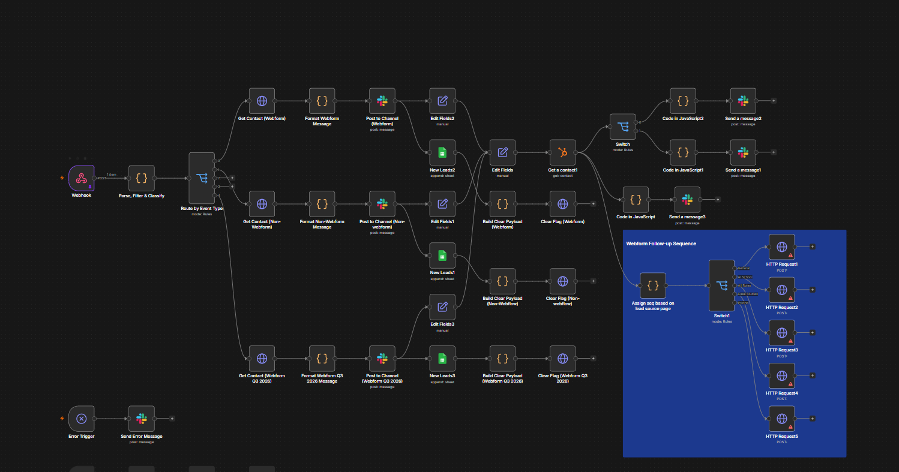

# Automated Outreach Pipeline

A **generalized technical case study** of an n8n workflow for scheduled record selection, integration handoffs, callback processing, and status tracking. This repository demonstrates workflow architecture and engineering methods without publishing an operational employer system.

## Overview

The automation coordinates a multi-stage outreach processing pipeline: selecting eligible records from a structured tracker, controlling batch execution, submitting normalized records to an external service, reacting to processing events, and recording status changes. The public-facing description intentionally omits business-specific campaign details, targeting rules, and proprietary configuration.

## Technology and concepts

- **n8n:** workflow orchestration, scheduling, conditional routing, and iteration
- **JavaScript:** filtering, normalization, state handling, and validation
- **Google Sheets:** structured tracking and record updates
- **HTTP / webhooks:** service handoffs and event callbacks
- **Processing controls:** batched execution, domain-level pacing, and workflow-state tracking

## Architecture

The accompanying [`workflow-architecture.json`](workflow-architecture.json) documents **54 generalized components and their connections**, retaining component categories and conceptual data contracts while omitting executable configuration.

```text
Scheduled batch selection
        │
        ▼
Validate and filter eligible records
        │
        ▼
Controlled iteration / external processing request
        │
        ▼
Receive event or callback ──► validate + branch by state
        │
        ▼
Apply processing limits / update tracking records
```

### Data flow

1. **Selection:** Read eligible entries from a tracking dataset using a scheduled trigger.
2. **Preparation:** Filter by processing state and normalize required fields.
3. **Execution:** Iterate through records and hand off generalized payloads to an external processing service.
4. **Response handling:** Accept inbound events, validate the state, and choose the appropriate branch.
5. **Pacing:** Apply processing controls so work can progress in manageable batches.
6. **Tracking:** Update status and timestamps to maintain operational visibility.

This is a conceptual explanation rather than an exact reproduction of private production logic.

## My role and contributions

- **Designed and developed** the automation workflow, including its overall structure, processing flow, and system handoffs.
- **Led testing** and validated execution paths and expected outputs.
- **Implemented improvements** based on testing findings and operational feedback.
- **Maintained and troubleshot** the workflow to support reliable ongoing execution.

## Repository contents

| File | Description |
| --- | --- |
| `workflow-architecture.json` | Detailed, non-runnable technical architecture: generalized nodes, connections, logic outlines, and illustrative payloads |
| `assets/` | Space for a separately reviewed, permitted workflow screenshot |

## Workflow screenshot

*Add `assets/workflow-overview.png` only after checking that the screenshot is approved for sharing and contains no internal data or company-specific details.*

<!-- Once the approved screenshot exists, uncomment the next line:

-->

## Confidentiality and limitations

This repository does **not** contain the original automation export, executable scripts, credentials, live API URLs, webhook paths, customer data, business-specific criteria, or employer-identifying information. All example records and payloads are fictional. The JSON is **not runnable and cannot be imported as a functioning n8n workflow**.

**Publication note:** Even anonymized workflow architecture may be protected by confidentiality or intellectual-property obligations. Keep the repository private until you have verified permission to publish the materials, including screenshots and the connection topology.
